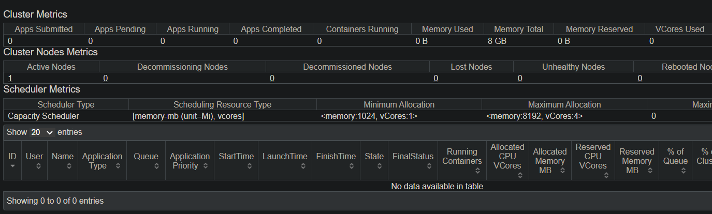
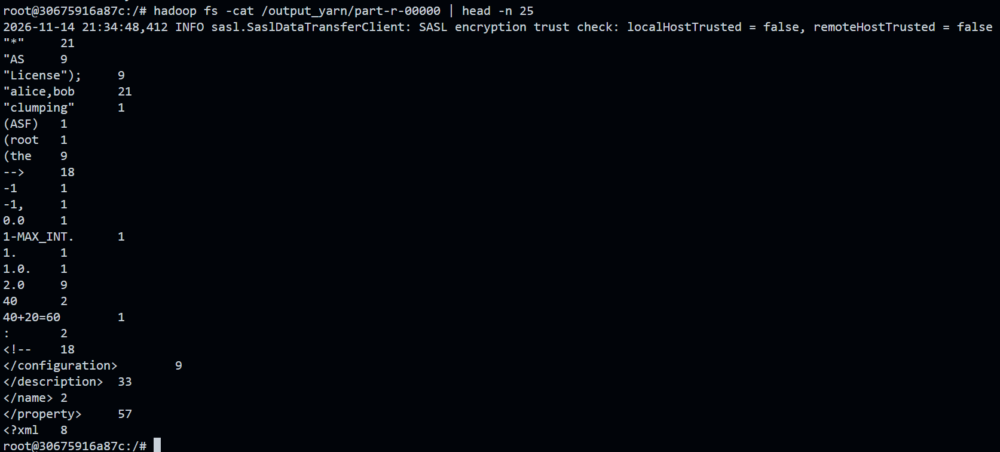

# Taller: Despliegue de Clúster Apache Hadoop (HDFS + YARN) con Docker y Procesamiento MapReduce

En este repositorio documentamos la arquitectura, la configuración, el despliegue y las evidencias de ejecución de nuestro clúster distribuido de Apache Hadoop levantado mediante contenedores en Docker. A lo largo de la práctica validamos el almacenamiento distribuido en HDFS, la gestión de recursos en YARN y el procesamiento paralelo utilizando el modelo MapReduce.

---

## 1. Arquitectura y Componentes del Clúster

Orquestamos el entorno distribuido mediante `docker-compose.yml` bajo una red interna aislada, integrando los siguientes servicios:

| Servicio / Contenedor | Rol en el Clúster | Puerto Web / Servicio |
| :--- | :--- | :--- |
| **`namenode`** | Nodo maestro de HDFS; gestiona el árbol de directorios y los metadatos de los bloques. | `9870` (UI) / `9000` (IPC) |
| **`datanode1` & `datanode2`** | Nodos trabajadores encargados del almacenamiento físico y la replicación de bloques en HDFS. | `9864` |
| **`resourcemanager`** | Gestor maestro de YARN; administra y asigna los recursos de cómputo (RAM/vCores) del clúster. | `8088` (UI) |
| **`nodemanager`** | Agente de cómputo por nodo; ejecuta los contenedores asignados por el ResourceManager. | `8042` |
| **`historyserver`** | Servidor de historial donde consultamos las métricas y logs de los trabajos MapReduce finalizados. | `8188` (UI) |

---

## 2. Estructura del Repositorio

Organizamos el proyecto de la siguiente manera para mantener separados la infraestructura, los datos de prueba, los comandos y las evidencias:

```text
taller_hadoop/
├── docker-compose.yml             # Orquestación de los contenedores del clúster Hadoop
├── hadoop.env                     # Variables de entorno y propiedades del clúster
├── data/
│   └── sample.txt                 # Dataset de entrada utilizado para pruebas en HDFS
├── scripts/
│   └── run_wordcount.sh           # Secuencia de comandos HDFS y MapReduce que ejecutamos
├── evidencias/
│   ├── 01_yarn_nodes.png          # Captura del nodo activo en la interfaz web de YARN
│   ├── 02_mapreduce_ejecucion.png # Captura de métricas y contadores del job MapReduce
│   └── 03_hdfs_resultado.png      # Captura de la salida procesada en HDFS
└── README.md                      # Documentación principal y reporte de evidencias
```

---

## 3. Guía de Despliegue y Ejecución

### Paso 1: Levantar la infraestructura en Docker
Desde la raíz del proyecto, inicializamos todos los servicios del clúster en segundo plano:

```bash
docker compose up -d
```

### Paso 2: Preparar el sistema de archivos distribuido (HDFS)
Ingresamos al contenedor maestro (`namenode`), creamos el directorio de entrada en HDFS y cargamos los archivos de prueba:

```bash
docker exec -it namenode bash
hadoop fs -mkdir -p /input
hadoop fs -put /etc/hadoop/*.xml /input
hadoop fs -ls /input
```

### Paso 3: Ejecutar procesamiento distribuido (MapReduce sobre YARN)
Lanzamos el algoritmo `WordCount` utilizando el paquete JAR nativo de ejemplos que incluye Hadoop:

```bash
hadoop jar /opt/hadoop-3.2.1/share/hadoop/mapreduce/hadoop-mapreduce-examples-3.2.1.jar wordcount /input /output_yarn
```

### Paso 4: Consultar los resultados en HDFS
Verificamos la generación del archivo de salida `part-r-00000` y leímos su contenido directamente desde HDFS:

```bash
hadoop fs -ls /output_yarn
hadoop fs -cat /output_yarn/part-r-00000
```

---

## 4. Evidencias de Funcionamiento

### 4.1. Sincronización del Clúster en YARN (`Active Nodes: 1`)
Verificamos a través del panel de control de YARN (`http://localhost:8088`) que el `nodemanager` se registró exitosamente frente al `resourcemanager`, habilitando la capacidad de cómputo del clúster para recibir y ejecutar trabajos distribuidos.



---

### 4.2. Ejecución y Métricas del Trabajo MapReduce
El trabajo de `WordCount` completó las fases de **Map (100%)** y **Reduce (100%)** en estado `SUCCEEDED` sin errores de comunicación ni pérdida de bloques entre nodos:

* **File Input Format Counters:** `Bytes Read = 30133`
* **File Output Format Counters:** `Bytes Written = 11903`
* **Shuffle Errors:** `BAD_ID=0`, `CONNECTION=0`, `IO_ERROR=0`, `WRONG_LENGTH=0`, `WRONG_MAP=0`, `WRONG_REDUCE=0`


---

### 4.3. Validación de Resultados en HDFS (`/output_yarn/part-r-00000`)
Finalmente, extrajimos el contenido del archivo resultante almacenado en HDFS, comprobando el conteo y ordenamiento alfabético de todas las palabras procesadas en paralelo por el clúster:

```text
"*"             21
"AS             9
"License");     9
Apache          10
License         27
The             54
and             70
for             65
is              76
of              77
the             139
```

